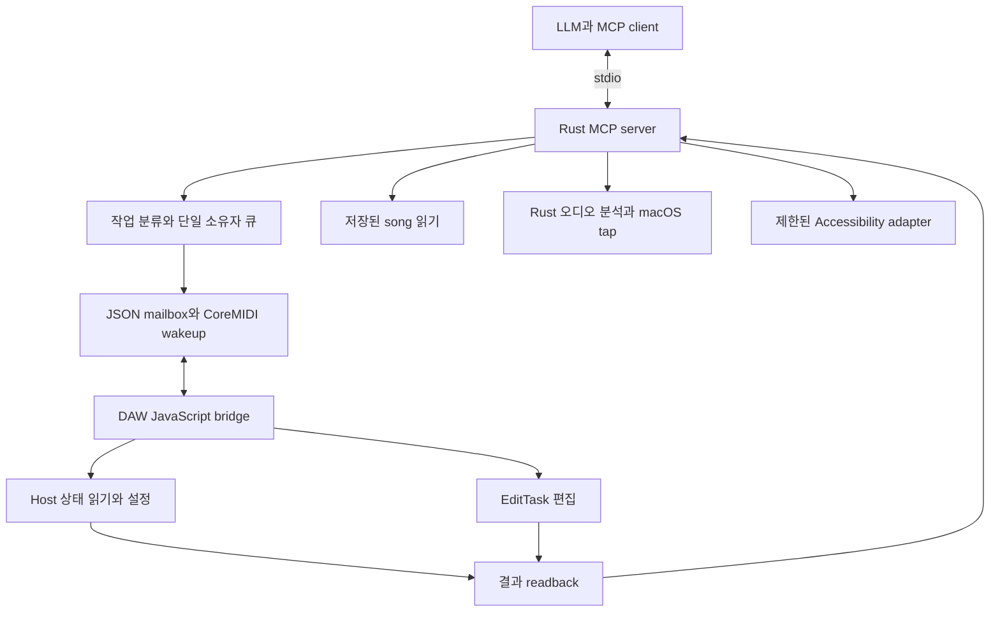

# Rust로 Fender Studio Pro를 제어하는 MCP 서버 구현 계획

macOS에서 LLM이 세션을 이해하고, 음악을 편집하고, 믹싱과 출력까지 수행하도록 만든다.
Rust 서버와 작은 DAW 내부 JavaScript control-surface 및 EditTask 확장을 함께 제공한다.
지원 범위는 명령 개수보다 실제 작업 완료와 결과 검증으로 판단한다.
사용자가 선택한 우선 플랫폼은 macOS다. 로컬 기준 앱은 Studio Pro 8.1.1 Build 113103이다.
P0부터 실제 호스트 증거를 쌓는다. Rust 서버, 브리지와 EditTask를 구현했고 실제 8.1.1에서
연결, 트랙/노트 편집, 내장 효과·악기·Note FX·Mix FX의 대표 제어를 검증했다.
단계 전체의 완료와 개별 기능의 통과를 구분한다. 현재 증거와 제한은
[실환경 검증](VALIDATION.md)과 [내장 플러그인 지원표](BUILTIN_PLUGINS.md)를 기준으로 읽는다.
참고 프로젝트의 버전과 한계는 [조사 문서](RESEARCH.md)에 기록했다.

## Current implementation checkpoint — 2026-11-09

macOS 8.1.1 실제 검증을 계속 진행해 Rust MCP 31개 도구, 브리지, EditTask와 선택 설치형 Rust CCL 확장을 구현했다. 최신 실행에서 내장 60종을 확인했고, 59개 현재 제공자의 8,668개 인덱스와 별도 Splitter 16개 고정 컨트롤을 읽었다. 59종의 파라미터/그래프 변경·읽기·복원과 Phase Meter 바이패스가 통과했다. External Effect 양 모드의 게인·믹스·수동 지연·위상·한글 메모, 공간 제어 36개 사례와 같은 빌드의 P0 회귀도 확인했다.

아래 P0–P5는 최초 계획과 아직 남은 게이트를 함께 보존한 문서다. 완료 여부는 [최신 검증](VALIDATION.md), [내장 플러그인 표](BUILTIN_PLUGINS.md), [정제한 증거](evidence/2026-11-09-native-provider.json)를 기준으로 읽는다. 하드웨어 포트 목록은 현재 노출된 항목이 0개였으며, 실제 라우팅·핑·오디오 신호, 전체 GUI/파일 동작과 모든 모델·선택 상태를 완료했다고 주장하지 않는다.

## How to read this

One box is one unit of work. Every box names the evidence that checks it. Check a box only when its evidence exists. 체크되지 않은 항목은 앞으로 수행할 작업이다.

실행할 때는 `$HOME/.local/share/pstack/current/upstream/skills/poteto-mode/playbooks/autopilot-stack.md`를 Codex adapter와 함께 적용한다. 이 문서는 실행 지시나 merge 권한을 부여하지 않는다. P0부터 실제 환경의 증거를 쌓고, 구현 범위가 커지면 같은 단계 안에서도 검증 가능한 작은 PR로 나눈다. 아래 P0부터 P5는 계획상의 작업 ID이며 아직 생성한 GitHub PR이 아니다.

Tests alone are not sufficient verification. A PR is verified only when its unit, live, and perf boxes are all checked.

지연과 파일 크기의 숫자는 초기 합격 기준 제안이다. 측정값이나 성능 보장으로 읽지 않는다. P0에서 머신, OS, 오디오 장치와 기준 fixture를 고정한다. 이후 기준을 바꾸면 이유와 변경 전후 측정 결과를 남긴다.

## Program checklist

### Arm the program

- [x] 사용자의 범위와 macOS 우선을 반영한다. 근거는 현재 대화와 이 계획이다.
- [x] 세 참고 저장소를 고정 커밋에서 조사한다. 근거는 `docs/RESEARCH.md`다.
- [x] 초기 빈 폴더에 저장소와 실행 규칙을 만들고 MIT 출처를 보존했다. 공개 remote는 `dev-universe/fender-studio-pro-mcp`다.
- [x] Git 기준 계획, `AGENTS.md`, 설치된 pstack와 Codex adapter를 읽고 실제 도구에 맞게 실행했다.
- [ ] skip. `/loop 1h` 감사 자동화는 이번 범위에 없다. Codex adapter에도 해당 실행기가 없다. 자동화를 만들지 않는다.
- [ ] 작업 중 status message는 새 증거, 실패, 범위 변경 또는 완료를 알린다. 권한이나 구현 동의를 반복해서 묻지 않는다.

### Spawn owners

- [ ] P0 → P1 → P2 → P3 → P4 → P5 순서를 지킨다. P0가 실패하면 해당 기능을 가능한 것으로 계획하지 말고 결과에 따라 수정한다.
- [x] 한 native owner가 DAW 제어 큐를 소유하며 profile OS lock으로 다른 프로세스를 차단한다. 실제 두 번째 프로세스도 `controller_busy`로 거절됐다.
- [x] agent별 파일 범위와 동일 모델 상속을 유지했다. 실제 앱 조작은 부모 작업자가 전용 scratch 세션에서 직렬 수행했다.
- [ ] 상호작용을 바꾸는 P1부터 P5는 merge 전에 도구 입출력과 DAW 화면 증거를 리뷰한다. 이번 계획 작성에는 앱 설치와 제어가 포함되지 않는다.

### PR mechanics, for every PR

- [ ] 실제 forge와 CI가 준비된 뒤 작은 PR로 제출한다. branch와 PR 제목에는 `codex`를 넣지 않는다.
- [ ] `cargo fmt --check`, `cargo clippy --all-targets -- -D warnings`, `cargo test`를 실행한다. Node는 JS 개발 테스트에만 사용하며 사용자 runtime 의존성으로 요구하지 않는다.
- [ ] 브리지 변경에는 실제 JS 파일을 실행하는 fake-host 계약 테스트를 추가한다. host API 존재 검사, 오류 값 반환, 스키마와 패키지 버전을 검사한다.
- [ ] Rust와 JS의 protocol schema를 하나의 기준에서 검증한다. 생성기를 미리 만들기보다 공통 fixture와 계약 테스트부터 둔다.
- [x] `THIRD_PARTY_NOTICES.md`와 `licenses/`에 MIT 출처를 보존하고 임의 eval을 제거했다.

### Verdict and merge, for every PR

- [ ] 정확한 head에서 unit, live와 perf 증거를 리뷰한다. 코드 존재나 빌드 성공을 실제 DAW 성공으로 대신하지 않는다.
- [ ] 실패한 live 시나리오를 고친 뒤 해당 시나리오와 영향을 받는 회귀 검증을 다시 실행한다. 변경이 없으면 같은 검증을 반복하지 않는다.
- [ ] 부모가 바뀌면 변경 영향을 확인하고 필요한 결과를 갱신한다. 확인하지 않은 head에 통과 판정을 붙이지 않는다.
- [ ] 검증된 PR은 의존 순서대로 리뷰 가능한 상태로 전달한다. merge와 배포는 해당 시점의 사용자 지시 범위를 따른다.

### Boot recipe, for every live lane

공통 증거 경로는 `artifacts/live/<phase>/<head>/<lane>/`다. 각 시나리오는 `result.json`, 요청과 응답 로그, `before.png`, `after.png`를 저장한다. 체크리스트의 PNG는 결과 화면이며 JSON과 함께 판정한다. 화면 촬영은 실제 UI 도구가 제공하는 경로를 이용한다.

- [ ] macOS의 실제 Studio Pro 설치, 앱과 bridge 버전, OS와 CPU, 샘플레이트, 오디오 장치, locale과 plugin 목록을 기록한다. 사용할 수 없는 라이선스나 VM을 있다고 가정하지 않는다.
- [ ] `fixtures/`의 seed에서 테스트 전용 복사본을 연다. 원본 작업 세션을 자동으로 저장하거나 덮어쓰지 않는다.
- [ ] 12개 이상의 트랙, 중복 이름, instrument note track과 audio channel, 폴더, bus, send, 내장 plugin, audio clip, MIDI notes, tempo와 박자 변경을 준비한다. 대규모 fixture는 별도로 생성한다.
- [ ] JSON-RPC stdio 클라이언트가 실제 빌드 binary를 구동한다. DAW 화면은 사용 가능한 native UI 도구로 확인한다. Cursor 전용 control skill은 설치돼 있지 않으므로 실행했다고 주장하지 않는다.
- [ ] ten lanes는 서로 다른 검증 시나리오다. 이 Mac에서는 한 DAW를 공유하므로 직렬 실행한다. agent를 쓰더라도 DAW 소유권은 하나다.
- [ ] trunk와 head에 같은 fixture와 입력을 적용한다. trunk에 기능이 없으면 부재를 기록하고 새 동작의 절대 기준을 검사한다. 다른 작업끼리 속도 비율을 계산하지 않는다.
- [ ] 테스트 종료 시 트랙과 채널 수, 대상 값, 선택, loop, 재생과 녹음 상태를 확인한다. 복원이 실패하면 별도 실패로 기록하고 원본으로 저장하지 않는다.

## 내부 제어 경로를 증명한다 (P0)

**Depends on.** None.

**Files.**

- [ ] `docs/COMPATIBILITY.md`, `fixtures/manifest.json`, `probes/`와 probe 결과를 만든다. 파일은 실제 실험 때 작성한다.

**Build.**

- [x] 실제 8.1.1에서 Host, 파일 IO, MIDI 및 timer callback, 명령 검색, MediaTime을 이용한 빈 part와 첫 노트 생성을 확인했다.
- [x] 8.1.1 profile의 User Devices/Extensions에 전용 자산을 설치했다. 설치 manifest/hash, 백업과 소유 파일 검사로 기존 파일을 구분한다.
- [ ] wakeup 전용 MIDI source를 control-surface 입력에만 연결한다. instrument와 All Inputs 경로로 흘러 note 119가 재생되거나 녹음되지 않는지 검사한다.
- [ ] callback에서 가능한 작업, EditTask가 필요한 작업, 불가능하거나 미확인인 작업을 capability 목록에 기록한다.
- [ ] host UID의 안정성, 선택과 focus 복원, 빈 MIDI part에 첫 노트를 넣는 경로를 확인한다. 객체 수명 이후 host handle을 재사용하지 않는다.

**You see.**

- [ ] 열린 문서를 읽고 테스트 채널 하나를 변경한 뒤 실제 값을 읽어 원래 값으로 복원한 증거가 남는다. no-document도 정상 상태로 보고한다.

**Verify, unit.** Tests alone are not sufficient verification. A PR is verified only when its unit, live, and perf boxes are all checked.

- [x] 실제 JS 자산을 VM에서 실행하는 계약 테스트로 요청/결과, 오류, 문서 검사, 일회성 EditTask, 여러 part와 플러그인 식별을 검증했다. 실행법은 `scripts/check.sh`다.

**Verify, live.** Tests alone are not sufficient verification. A PR is verified only when its unit, live, and perf boxes are all checked. Ten lanes on `inherit-parent` at the PR head. 공통 boot recipe를 따른다.

- [ ] Lane 1. Regression lane against trunk. 기존 제어 기능의 유무를 확인하고 동일 scratch 세션에서 ping과 readback을 비교한다. Save `p0-01.png`. Pass when 새 경로만으로 ping과 값 복원이 확인된다.
- [ ] Lane 2. 브리지 로드와 protocol을 조회한다. Save `p0-02.png`. Pass when 버전과 session이 일치한다.
- [ ] Lane 3. 앱에 문서가 없는 상태를 읽는다. Save `p0-03.png`. Pass when 모달 오류 없이 no-document다.
- [ ] Lane 4. 중복 이름 트랙을 조회한다. Save `p0-04.png`. Pass when 각 대상이 구별되거나 모호함을 거절한다.
- [ ] Lane 5. MIDI wakeup을 반복 전송한다. Save `p0-05.png`. Pass when 같은 요청이 한 번만 적용되고 instrument에 원치 않는 note가 생기지 않는다.
- [ ] Lane 6. 큐 대기 중 다른 문서로 전환한다. Save `p0-06.png`. Pass when 이전 대상 쓰기를 거절한다.
- [ ] Lane 7. 빈 part 생성과 첫 노트 추가를 실행한다. Save `p0-07.png`. Pass when 음높이와 beat가 다시 읽힌다.
- [ ] Lane 8. 잘못된 host member와 미지원 operation을 요청한다. Save `p0-08.png`. Pass when Scripting Error 모달 없이 값으로 실패한다.
- [ ] Lane 9. DAW 종료 후 재실행한다. Save `p0-09.png`. Pass when 이전 session을 버리고 다시 연결한다.
- [ ] Lane 10. 트랙 추가 후 readback 시점을 관찰한다. Save `p0-10.png`. Pass when 지연 적용과 성공 조건이 기록된다.

**Verify, perf.** Tests alone are not sufficient verification. A PR is verified only when its unit, live, and perf boxes are all checked.

- [x] Metric. 실제 64-track 세션에서 warm ping 100회와 snapshot 20회의 p50/p95/timeout을 기록했다. `docs/VALIDATION.md`를 참조한다.
- [ ] Probe. 준비된 프로세스에서 ping 100회와 snapshot 20회를 trunk와 head에 번갈아 실행한다. 실제 명령은 P0 probe와 함께 고정한다.
- [ ] Baseline. 초기 trunk는 구현이 없어 absent로 기록했다. 전체 MCP 왕복은 측정했으며, MIDI/host callback/파일 응답의 개별 프로파일링은 미완료다.
- [x] Rule. 단일 warm run에서 ping p95 78.31ms, 64-track snapshot p95 75.41ms, 오류와 timeout 0회로 제안 기준을 통과했다. 다른 머신이나 대규모 세션의 보장은 아니다.

**Review gate.** None. P0 is not review-gated. 실험 결과와 한계가 다음 단계의 설계를 결정한다.

**Merge.**

- [ ] 정확한 head의 probe 로그, 지원표와 실패 항목을 리뷰 가능한 상태로 전달한다. 이 단계에서 전 기능 지원을 선언하지 않는다.

## Rust 서버와 상태 관찰을 만든다 (P1)

**Depends on.** P0.

**Files.**

- [ ] `Cargo.toml`, `src/{main,mcp,model,executor,bridge,platform,install,doctor,song}/`, `assets/bridge/`, `tests/`를 만든다. 처음에는 단일 crate의 모듈로 시작한다.

**Build.**

- [x] 공식 `rmcp`, Tokio, Serde/schema, tracing 기반 stdio 서버와 Cargo.lock/MSRV를 제공한다. 실제 MCP 초기화와 도구 호출을 확인했다.
- [x] `serve`, `doctor`, `install`, `uninstall`과 embedded 자산, 설치 manifest/hash와 보존 검사를 구현하고 단위 테스트했다.
- [x] profile OS lock, bounded native owner queue, session/document 사전조건, request ID와 timeout의 unknown 결과를 구현했다. 제어 프로세스는 하나다. 재연결 제한은 검증 문서에 남겼다.
- [ ] CoreMIDI 가상 source를 만들고 재시작 후 연결을 확인한다. IAC 설정을 기본 설치 조건으로 요구하지 않는다. 포트 이름만으로 identity 유지가 된다고 가정하지 않는다.
- [ ] live snapshot과 capability 조회, 명령 검색을 제공한다. `.song` ZIP, XML과 UBJSON 읽기와 autosave 비교는 live와 별도 출처로 반환한다.
- [ ] 비정상 archive의 entry 수, 압축 해제 총량과 입력 크기를 제한한다. 파일은 읽기 전용으로 다루고 저장 파일을 직접 수정하는 쓰기 경로를 만들지 않는다.

**You see.**

- [ ] LLM이 열린 세션의 트랙과 믹서를 읽고, 저장본과 미저장 상태를 구별한다. 두 번째 서버는 기존 mailbox에 쓰지 않고 `controller_busy`를 반환한다.

**Verify, unit.** Tests alone are not sufficient verification. A PR is verified only when its unit, live, and perf boxes are all checked.

- [ ] schema, BOM과 부분 파일, 다른 session 응답, lock 경쟁, deadline, queue 취소, archive 제한과 tempo 단위 fixture를 `cargo test`로 검증한다.

**Verify, live.** Tests alone are not sufficient verification. A PR is verified only when its unit, live, and perf boxes are all checked. Ten lanes on `inherit-parent` at the PR head. 공통 boot recipe를 따른다.

- [ ] Lane 1. Regression lane against trunk. P0 ping과 snapshot을 Rust에서도 반복한다. Save `p1-01.png`. Pass when 동일 문서와 값이 반환된다.
- [ ] Lane 2. 실제 stdio 초기화와 tools 및 resource 조회를 수행한다. Save `p1-02.png`. Pass when JSON-RPC와 스키마가 유효하다.
- [ ] Lane 3. 미저장 변경과 saved snapshot을 비교한다. Save `p1-03.png`. Pass when 출처와 차이가 명확하다.
- [ ] Lane 4. 서버 두 개를 동시에 시작한다. Save `p1-04.png`. Pass when 소유자만 mailbox를 쓴다.
- [ ] Lane 5. 서버와 DAW를 각각 재시작한다. Save `p1-05.png`. Pass when 포트 재연결 또는 필요한 조치를 진단한다.
- [ ] Lane 6. request와 response를 부분 기록하거나 오래된 응답을 남긴다. Save `p1-06.png`. Pass when 잘못된 결과를 채택하지 않는다.
- [ ] Lane 7. 요청 대기 중 문서를 닫는다. Save `p1-07.png`. Pass when 문서 참조를 무효화한다.
- [ ] Lane 8. 설치, 재설치와 제거를 수행한다. Save `p1-08.png`. Pass when 사용자 자산과 설정이 보존된다.
- [ ] Lane 9. 지원 범위를 넘는 곡과 읽을 수 없는 preset을 조회한다. Save `p1-09.png`. Pass when 누락과 제한을 명시한다.
- [ ] Lane 10. 모달 창이나 잘못된 MIDI 설정에서 doctor를 실행한다. Save `p1-10.png`. Pass when 추측한 성공 대신 단계별 진단을 반환한다.

**Verify, perf.** Tests alone are not sufficient verification. A PR is verified only when its unit, live, and perf boxes are all checked.

- [ ] Metric. ping, snapshot과 saved-song read 지연, 메모리 사용량과 요청 유실을 기록한다.
- [ ] Probe. P0 probe를 실제 Rust binary에 연결하고 같은 seed를 trunk와 head에 번갈아 사용한다. archive 입력도 동일하게 고정한다.
- [ ] Baseline. P0 실측과 trunk에서 가능한 지표를 먼저 기록한다. 새 파일 파서는 별도 절대 기준을 사용한다.
- [ ] Rule. P0 ping과 snapshot 기준을 유지한다. 25MiB saved fixture 읽기 2초 이하, peak RSS 256MiB 이하를 초기 기준으로 둔다. 압축 해제 제한을 통과한 입력만 측정한다.

**Review gate.** merge 전에 도구의 관찰 결과와 설치 흐름을 리뷰한다.

- [ ] operator에게 snapshot과 진단 screenshot 및 30초부터 60초 video를 제공한다. 실제 표시는 버전과 출처를 포함한다.

**Merge.**

- [ ] 실제 MCP 왕복, lock 경쟁과 설치 복구 증거를 exact head에 연결한다.

## Transport와 기본 믹싱을 완성한다 (P2)

**Depends on.** P1.

**Files.**

- [ ] `src/operations/{transport,mixer,tracks,commands,snapshots}.rs`, 관련 bridge 연산과 `tests/live/`를 만든다.

**Build.**

- [ ] play, stop, seek, tempo, loop, metronome과 channel gain, pan, mute, solo, arm, monitor를 지원한다. 가능하면 toggle 대신 목표 상태를 설정한다.
- [ ] track 생성, 삭제, 이름과 색상, 선택, 폴더, 순서와 bus 및 VCA의 기초 연산을 제공한다. track과 channel을 구분한다.
- [ ] 각 쓰기는 대상과 precondition을 검사한 뒤 실행하고 readback한다. dB, linear gain과 normalized value를 타입과 스키마에서 구분한다.
- [ ] undo와 snapshot 복구 가능 범위를 연산별로 표시한다. 늦게 생기는 undo와 미복원 상태를 숨기지 않는다.
- [ ] command 검색과 실행에는 현재 enabled 상태, 문서, 선택과 focus 요구를 포함한다. 모든 진입점은 공통 작업 분류와 실행 검증을 거친다.

**You see.**

- [ ] 사용자가 지정한 보컬의 볼륨과 pan을 바꾸고 solo를 해제한 뒤, 바뀐 대상과 실제 값을 확인할 수 있다. 같은 이름의 다른 채널은 바뀌지 않는다.

**Verify, unit.** Tests alone are not sufficient verification. A PR is verified only when its unit, live, and perf boxes are all checked.

- [ ] gain 변환, 절대와 상대 값, 중복 이름 거절, stale handle, 목표 상태 재실행과 공통 command 분류를 `cargo test`로 검증한다.

**Verify, live.** Tests alone are not sufficient verification. A PR is verified only when its unit, live, and perf boxes are all checked. Ten lanes on `inherit-parent` at the PR head. 공통 boot recipe를 따른다.

- [ ] Lane 1. Regression lane against trunk. 전체 snapshot과 기본 제어를 같은 seed에서 비교한다. Save `p2-01.png`. Pass when 기존 읽기가 유지되고 새 제어가 확인된다.
- [ ] Lane 2. 재생, 정지, seek와 loop를 설정한다. Save `p2-02.png`. Pass when 위치와 상태가 readback과 일치한다.
- [ ] Lane 3. gain과 pan을 설정하고 복원한다. Save `p2-03.png`. Pass when 표시 단위와 실제 값이 허용 오차 안이다.
- [ ] Lane 4. mute와 solo를 같은 목표로 두 번 설정한다. Save `p2-04.png`. Pass when 상태가 반전되지 않는다.
- [ ] Lane 5. 중복 이름과 instrument note 및 audio 대상을 선택한다. Save `p2-05.png`. Pass when 지정한 객체만 바뀐다.
- [ ] Lane 6. track을 추가하고 이동, 폴더 편입과 제거를 수행한다. Save `p2-06.png`. Pass when 순서와 개수가 예상과 같다.
- [ ] Lane 7. bus와 VCA를 만들고 대상 연결을 확인한다. Save `p2-07.png`. Pass when 원치 않은 채널 연결이 없다.
- [ ] Lane 8. 수동 편집을 끼워 넣고 오래된 snapshot을 복구한다. Save `p2-08.png`. Pass when 충돌을 탐지하거나 대상별 차이를 보고한다.
- [ ] Lane 9. 녹음 연산을 transport와 generic command 양쪽으로 요청한다. Save `p2-09.png`. Pass when 같은 전제조건과 사용자 작업 범위 검사가 적용된다.
- [ ] Lane 10. 적용 직후 응답을 유실시킨다. Save `p2-10.png`. Pass when 결과 불명을 표시하고 비멱등 작업을 재전송하지 않는다.

**Verify, perf.** Tests alone are not sufficient verification. A PR is verified only when its unit, live, and perf boxes are all checked.

- [ ] Metric. 기본 채널 설정부터 검증까지의 지연과 bounded queue 대기 시간을 기록한다.
- [ ] Probe. 하나의 채널 설정과 복원을 50회 수행한다. 같은 입력으로 trunk와 head를 번갈아 측정한다. 재생 상태도 기록한다.
- [ ] Baseline. P1에 쓰기가 없으면 absent와 P1 readback 지연을 별도로 기록한다.
- [ ] Rule. 기본 set과 readback p95 1.5초 이하, wrong-target 0회, queue 초과 시 명시적 busy 응답을 초기 기준으로 둔다.

**Review gate.** merge 전에 실제 편집 결과를 리뷰한다.

- [ ] operator에게 중복 이름 대상 변경 screenshot과 복원까지 포함한 video를 제공한다.

**Merge.**

- [ ] 읽기, 쓰기와 복구를 함께 증명한 head를 전달한다. 검증할 수 없는 상태를 성공으로 표시하지 않는다.

## MIDI와 편곡 편집을 제공한다 (P3)

**Depends on.** P2.

**Files.**

- [ ] `src/operations/{events,notes,arranger,tempo,markers}.rs`, `assets/edit-tasks/`, 음악 편집 fixture와 live tests를 만든다.

**Build.**

- [ ] MIDI part 생성과 노트 조회, 추가, 삭제, transpose, velocity, 길이, 이동과 quantize를 제공한다. beat는 quarter-note 기준으로 정의한다.
- [ ] audio 및 MIDI event 이동, 복제, split, trim, gain과 fade를 지원한다. 실제 host가 노출한 기능만 제공한다.
- [ ] marker와 arranger 구간의 조회, 생성, 이름과 경계 변경, 내용 복사 및 이동을 분리한다. 구간 라벨 이동과 전체 트랙 내용 이동을 같은 연산으로 부르지 않는다.
- [ ] tempo map과 박자 변경, seconds와 beat 및 bar 변환을 검증한다. ramp가 미지원이면 해당 변환을 거절하거나 근사임을 명시한다.
- [ ] 여러 연산의 preview와 항목별 결과를 제공한다. batch는 기본적으로 비원자적이며 부분 적용과 복구 실패를 보고한다.
- [ ] audio comping, take와 layer는 현재 host에서 읽고 복원할 수 있는 작업부터 추가한다. 미지원 작업은 command 실행 성공으로 대신하지 않는다.

**You see.**

- [ ] LLM이 8마디 MIDI part를 만들고 노트를 입력한 뒤, 1/16 quantize와 velocity 조절을 수행한다. 다시 읽은 pitch, beat와 길이로 결과를 설명한다.

**Verify, unit.** Tests alone are not sufficient verification. A PR is verified only when its unit, live, and perf boxes are all checked.

- [ ] tick과 beat 및 초 변환, 변박, tempo 변경과 ramp 거절, note 경계, partial batch와 EditTask 계약을 `cargo test`와 JS 계약 테스트로 검증한다.

**Verify, live.** Tests alone are not sufficient verification. A PR is verified only when its unit, live, and perf boxes are all checked. Ten lanes on `inherit-parent` at the PR head. 공통 boot recipe를 따른다.

- [ ] Lane 1. Regression lane against trunk. P2 mixer와 선택 복원 시나리오를 재실행한다. Save `p3-01.png`. Pass when 편집 뒤 기존 제어가 유지된다.
- [ ] Lane 2. 빈 세션에 part와 첫 노트를 만든다. Save `p3-02.png`. Pass when 모든 입력 노트를 다시 읽는다.
- [ ] Lane 3. 1/16, triplet과 dotted quantize를 적용한다. Save `p3-03.png`. Pass when 지정한 grid와 strength 결과가 일치한다.
- [ ] Lane 4. pitch와 beat 범위로 노트를 편집한다. Save `p3-04.png`. Pass when 범위 밖 노트가 보존된다.
- [ ] Lane 5. audio event를 split하고 gain과 fade를 바꾼다. Save `p3-05.png`. Pass when 경계와 값 및 복구 결과가 일치한다.
- [ ] Lane 6. 편곡 라벨만 이동한 경우와 내용을 복사한 경우를 비교한다. Save `p3-06.png`. Pass when 영향 범위가 명세와 같다.
- [ ] Lane 7. 4/4와 7/8, tempo 변경을 포함한 위치 변환을 검사한다. Save `p3-07.png`. Pass when host와 허용 오차 안에서 일치한다.
- [ ] Lane 8. marker와 tempo 조회 중 재생 상태를 검사한다. Save `p3-08.png`. Pass when 순수 조회가 불가능하면 부작용 조건을 먼저 거절하거나 표시한다.
- [ ] Lane 9. 중간에 실패하는 편집 batch를 요청한다. Save `p3-09.png`. Pass when 적용 항목과 미적용 항목 및 복구 상태를 구별한다.
- [ ] Lane 10. unrelated track과 선택을 둔 채 편집과 undo를 수행한다. Save `p3-10.png`. Pass when 다른 대상의 내용이 보존된다.

**Verify, perf.** Tests alone are not sufficient verification. A PR is verified only when its unit, live, and perf boxes are all checked.

- [ ] Metric. 1,000-note batch 편집과 readback 지연, 취소 관찰 시간과 host 응답성을 기록한다.
- [ ] Probe. 동일 note fixture에 transpose와 복원을 trunk와 head에서 번갈아 실행한다. 한 노트당 MCP 왕복을 하지 않는다.
- [ ] Baseline. trunk에 note 편집이 없으면 absent와 동일 note snapshot 읽기 시간을 각각 기록한다.
- [ ] Rule. 1,000-note batch와 검증은 초기 5초 이하를 목표로 한다. 취소 후 새 chunk를 시작하지 않으며 부분 적용을 보고한다. host가 진행 중인 동기 작업을 즉시 취소할 수 있다고 보장하지 않는다.

**Review gate.** merge 전에 음악 편집과 복구 결과를 리뷰한다.

- [ ] operator에게 note editor와 arranger의 before 및 after screenshot과 video를 제공한다.

**Merge.**

- [ ] note 값과 event 경계의 구조화 비교 및 실제 화면 증거를 exact head에 연결한다.

## 플러그인과 라우팅 및 자동화를 확장한다 (P4)

**Depends on.** P3.

**Files.**

- [ ] `src/operations/{plugins,routing,automation}.rs`, `src/catalog/`, plugin fixture와 capability별 검증을 만든다.

**Build.**

- [ ] plugin catalog, insert 추가와 bypass, 알려진 parameter 조회와 설정을 제공한다. classID와 instance handle, parameter ID 또는 이름 및 raw와 normalized와 display text를 구분한다.
- [ ] 발견한 parameter와 전체 parameter를 구분한다. 내장 plugin remote map을 우선 지원하고, 타사 plugin은 실제 노출 범위와 미확인 값을 반환한다.
- [ ] bus와 output routing, send level과 mute를 지원한다. 기존 bus로 새 send를 만드는 경로는 별도 probe에서 확인된 경우에만 활성화한다.
- [ ] automation mode와 읽기를 지원한다. 직접 point 쓰기를 먼저 조사한다. 불가능하면 실제 재생으로 기록하는 기능을 별도 capability로 제공하고 원본 automation 보존과 복구 범위를 밝힌다.
- [ ] mix와 plugin snapshot의 포함 필드와 제외 필드를 반환한다. 알려진 parameter snapshot을 plugin 전체 state라고 부르지 않는다.

**You see.**

- [ ] LLM이 특정 채널에 내장 EQ를 넣고 노출된 주파수 파라미터를 바꾼 뒤 실제 값을 읽는다. 미노출 타사 parameter와 send 경로는 제한을 명시한다.

**Verify, unit.** Tests alone are not sufficient verification. A PR is verified only when its unit, live, and perf boxes are all checked.

- [ ] parameter 단위와 enum, 범위 밖 값, plugin 교체 후 stale handle, routing 충돌과 snapshot 부분 범위를 `cargo test`로 검증한다.

**Verify, live.** Tests alone are not sufficient verification. A PR is verified only when its unit, live, and perf boxes are all checked. Ten lanes on `inherit-parent` at the PR head. 공통 boot recipe를 따른다.

- [ ] Lane 1. Regression lane against trunk. P3 note와 event를 plugin 편집 전후에 비교한다. Save `p4-01.png`. Pass when 음악 데이터가 보존된다.
- [ ] Lane 2. 내장 EQ를 삽입하고 bypass를 설정한다. Save `p4-02.png`. Pass when instance와 bypass 상태가 확인된다.
- [ ] Lane 3. raw와 normalized 및 display text로 같은 parameter를 설정한다. Save `p4-03.png`. Pass when 실제 값과 단위가 일치한다.
- [ ] Lane 4. 타사 AU 또는 VST3 plugin을 조회한다. Save `p4-04.png`. Pass when 알려진 범위와 누락을 구별한다. 미설치면 지원 근거 없음으로 남긴다.
- [ ] Lane 5. 앞 insert를 삭제하거나 순서를 바꾼다. Save `p4-05.png`. Pass when 이전 handle로 다른 plugin을 수정하지 않는다.
- [ ] Lane 6. bus와 output routing을 변경하고 복원한다. Save `p4-06.png`. Pass when 목적지와 복구 상태가 일치한다.
- [ ] Lane 7. 새 FX send와 기존 bus send 경로를 각각 검사한다. Save `p4-07.png`. Pass when 가능한 경로만 capability에 표시한다.
- [ ] Lane 8. plugin과 mix snapshot을 복구한다. Save `p4-08.png`. Pass when 포함 필드만 적용하고 미복구를 보고한다.
- [ ] Lane 9. automation mode와 기존 곡선을 읽는다. Save `p4-09.png`. Pass when 값과 쓰기 가능 경로가 실제 host와 맞는다.
- [ ] Lane 10. 전용 복사본에서 automation 기록을 취소하거나 실패시킨다. Save `p4-10.png`. Pass when 재생과 mode 복구 및 partial 결과가 확인된다. 기록 미지원이면 그 결과를 명시한다.

**Verify, perf.** Tests alone are not sufficient verification. A PR is verified only when its unit, live, and perf boxes are all checked.

- [ ] Metric. plugin 삽입 및 parameter set의 검증 지연, catalog cache와 snapshot 비용을 기록한다.
- [ ] Probe. 같은 내장 EQ와 세션에서 bypass, parameter set과 복원을 trunk와 head에 교차 실행한다. 초기 plugin 로딩은 따로 측정한다.
- [ ] Baseline. trunk에 없는 작업은 absent로 기록한다. 기존 snapshot 지연은 같은 필드 집합으로 비교한다.
- [ ] Rule. warm parameter set과 readback p95 1.5초 이하, 내장 EQ 삽입과 발견 10초 이하를 초기 기준으로 둔다. offline automation은 곡 길이와 별도 비교하고 realtime 기록을 가속했다고 표현하지 않는다.

**Review gate.** merge 전에 mixer와 plugin 및 automation 동작을 리뷰한다.

- [ ] operator에게 parameter readback, routing과 automation 복구 screenshot 및 video를 제공한다.

**Merge.**

- [ ] 확인한 plugin과 host 버전, 미지원 parameter와 routing 경로를 지원표에 반영한 head를 전달한다.

## 오디오 검증과 출력 및 배포를 완성한다 (P5)

**Depends on.** P4.

**Files.**

- [ ] `src/{audio,jobs}/`, `src/platform/macos/`, `src/operations/{record,export,files}.rs`, `packaging/`, `docs/USAGE.md`와 release CI를 만든다.

**Build.**

- [ ] 먼저 WAV 파일 분석을 Rust로 구현한다. loudness, sample과 true peak, clipping, band energy 및 stereo 지표를 기준 신호와 독립 분석 결과로 검증한다.
- [ ] Core Audio process tap을 붙인다. capture ready 이후 재생하고 원래 재생 상태와 위치를 별도로 복구한다. 실시간 callback에서는 할당, 파일 IO와 blocking lock을 하지 않는다.
- [ ] 녹음, bounce, capture와 export를 job으로 추적한다. start, status, cancel과 결과 artifact를 제공한다. 클라이언트가 최신 MCP task 기능을 지원하지 않아도 동작하게 한다.
- [ ] mixdown과 stems는 실제 command 인자 지원을 먼저 확인한다. 부족하면 제한된 Accessibility adapter로 대화상자를 처리하고 파일 생성 완료, 포맷, 길이와 채널을 확인한다.
- [ ] UI fallback은 접근성 트리와 앱 및 문서 identity를 사용한다. 좌표와 언어별 텍스트에만 의존하는 자동화는 일반 지원으로 승격하지 않는다. 다른 앱으로 focus가 가면 중단한다.
- [ ] macOS 최소 OS를 기능별로 확정한다. system audio 권한, `NSAudioCaptureUsageDescription`, 서명과 notarization, Apple Silicon 및 Intel 산출물의 실제 테스트 범위를 기록한다.
- [ ] Windows adapter는 인터페이스와 후속 backlog만 정리한다. Windows runtime 검증이 없으면 지원한다고 표시하지 않는다.

**You see.**

- [ ] LLM이 변경 전후 같은 구간을 캡처해 측정 차이를 비교하고, 지정한 출력 파일이 완성됐는지 확인한다. 전송 완료와 렌더 완료를 구분한다.

**Verify, unit.** Tests alone are not sufficient verification. A PR is verified only when its unit, live, and perf boxes are all checked.

- [ ] 합성 신호와 기준 파일, job lifecycle, timeout 후 unknown 결과, 출력 경로 충돌과 cancel 및 복구 실패를 `cargo test`로 검증한다. 분석 결과의 표준 적합성은 사용한 기준 신호 범위만 주장한다.

**Verify, live.** Tests alone are not sufficient verification. A PR is verified only when its unit, live, and perf boxes are all checked. Ten lanes on `inherit-parent` at the PR head. 공통 boot recipe를 따른다.

- [ ] Lane 1. Regression lane against trunk. 동일 구간을 변경 전후 같은 시작점과 설정으로 재생한다. Save `p5-01.png`. Pass when 초기 transient와 비교 구간이 보존된다.
- [ ] Lane 2. tap 권한 허용과 거부를 검사한다. Save `p5-02.png`. Pass when 권한 오류를 정상 무음으로 보고하지 않는다.
- [ ] Lane 3. 알려진 무음과 mono 및 antiphase 신호를 분석한다. Save `p5-03.png`. Pass when 지표와 경계값이 기준과 일치한다.
- [ ] Lane 4. capture 도중 DAW 종료와 오디오 장치 변경을 수행한다. Save `p5-04.png`. Pass when job 실패와 정리가 보고된다.
- [ ] Lane 5. 테스트용 track에 녹음하고 취소한다. Save `p5-05.png`. Pass when take와 transport 및 부분 파일 상태가 확인된다.
- [ ] Lane 6. bounce와 undo를 수행한다. Save `p5-06.png`. Pass when 남은 파일까지 결과에 표시한다.
- [ ] Lane 7. mixdown 파일을 생성한다. Save `p5-07.png`. Pass when 실제 파일의 길이와 format 및 완료 상태가 확인된다. 경로 미확인 시 미지원으로 남긴다.
- [ ] Lane 8. stems를 생성하고 이름과 수를 검사한다. Save `p5-08.png`. Pass when 누락과 중복 없이 대상별 파일이 확인된다. 경로 미확인 시 미지원으로 남긴다.
- [ ] Lane 9. export UI 중 다른 앱으로 focus를 옮긴다. Save `p5-09.png`. Pass when 다른 앱에 키를 보내지 않고 중단한다.
- [ ] Lane 10. 서명된 배포 산출물을 개발 환경 밖의 지원 Mac에 설치한다. Save `p5-10.png`. Pass when Node와 Python 설치 없이 MCP, 진단과 지원 기능이 동작한다. 미실행 architecture는 미검증으로 남긴다.

**Verify, perf.** Tests alone are not sufficient verification. A PR is verified only when its unit, live, and perf boxes are all checked.

- [ ] Metric. 오디오 callback overrun과 drop 수, buffer 상한, 파일 분석 realtime factor 및 capture 시작 정렬을 기록한다.
- [ ] Probe. 같은 10분 stereo 48kHz 파일과 tap 구간을 trunk와 head에서 번갈아 측정한다. 1분과 10분 capture의 메모리 증가도 비교한다.
- [ ] Baseline. trunk에 분석이 없으면 absent로 기록하고 독립 분석기 결과와 새 작업의 절대 비용을 비교한다. 실시간 capture와 offline 분석의 속도 비율을 혼동하지 않는다.
- [ ] Rule. 테스트 중 buffer drop 0회, 10분 capture peak RSS 256MiB 이하, 10분 파일 분석 60초 이하를 초기 기준으로 둔다. host의 렌더 속도는 별도 기록한다. 취소는 2초 이내 상태를 보고하며 즉시 host 취소가 불가능하면 pending과 사유를 명시한다.

**Review gate.** merge 전에 녹음과 출력 및 배포 경험을 리뷰한다.

- [ ] operator에게 job 결과와 파일 검사 screenshot, 캡처 시작부터 완료까지의 video를 제공한다. 권한이 없는 기능은 활성 기능으로 소개하지 않는다.

**Merge.**

- [ ] exact head의 설치 증거, 출력 파일 검사, 분석 비교와 지원표를 연결해 전달한다.

## Close the program

- [ ] 완료한 capability마다 host와 OS 버전, 읽기와 쓰기 및 검증 범위, 전제조건과 증거를 기록한다. 미완료와 실험 기능을 별도로 남긴다.
- [ ] 전체 scratch 시나리오에서 다른 트랙 변경, 중복 적용, 설명되지 않은 파일 덮어쓰기와 복원 성공 오보고가 없는지 확인한다.
- [ ] 지원표에 따른 release를 만든다. 광범위한 제어라는 표현이 미지원 automation, plugin, export 또는 Project와 Show 작업을 포함한다고 오해되지 않게 한다.
- [ ] 사용법에 설치, 연결, 기능 탐색, 단위, 제한, 결과 불명과 복구 예제를 포함한다. 실행하지 않은 작업을 체크하지 않는다.

## Appendix A. Prototype evidence

최초 계획 작성 시점에는 조사만 진행했고 prototype, branch, SHA와 DAW screenshot은 없었다. 이후의 실제 구현과 증거는 이 문서 앞의 최신 체크포인트와 VALIDATION.md를 기준으로 읽는다. 당시에는 저장소 소스와 로컬 앱 버전 metadata만 확인했다. 참고 프로젝트의 저자 보고와 직접 검증을 구별한 근거는 [RESEARCH.md](RESEARCH.md)에 있다.

먼저 해결할 실험 질문은 다음과 같다.

| 질문 | 실험과 판정 | 실패 시 방향 |
| --- | --- | --- |
| 8.1.1에서 file mailbox와 MIDI callback이 동작하는가 | 실제 ping과 readback 및 재시작 확인 | context와 device 등록부터 수정한다. 작동 전 대규모 포팅을 시작하지 않는다. |
| 빈 part와 첫 노트를 만들 수 있는가 | EditTask로 생성 후 note 읽기 | MIDI import 대안을 별도 검증하고 직접 편집 지원을 낮춘다. |
| object UID를 언제까지 믿을 수 있는가 | reorder, rename, 삭제와 문서 교체 비교 | 문서 수명에 묶인 opaque handle과 쓰기 직전 재확인을 쓴다. |
| profile을 다시 열어도 가상 MIDI가 연결되는가 | 서버와 DAW 재시작 순서 조합 | native endpoint identity 설정을 보완하고 doctor에 수동 조치를 표시한다. |
| automation point와 기존 bus send를 직접 편집할 수 있는가 | 해당 host API와 작은 scratch 편집 | 간접 경로와 기능 제한을 공개한다. |
| mixdown과 stems를 dialog 없이 완료할 수 있는가 | command argument와 실제 출력 파일 확인 | 검증된 Accessibility 경로만 선택적으로 활성화한다. |

## Appendix B. Alternatives rejected

### 제어 방식을 선택한다

| 방식 | 판단 |
| --- | --- |
| Rust 서버와 내부 JS 및 EditTask | 권장. 현재 소스에서 가장 넓은 의미 단위 편집 경로다. host API와 버전 호환성 검증은 필요하다. |
| Rust와 MCU만 사용 | transport와 제한된 mixer 보조 경로다. 안정적인 전체 곡 ID와 노트 및 편곡 편집의 주 경로로 부족하다. |
| 키보드와 화면 자동화 중심 | export 같은 빈틈에 제한한다. focus, locale과 modal 창의 영향 때문에 주 경로로 삼지 않는다. |
| UCNET 우선 구현 | 이번 근거에는 구현된 protocol이 없다. 포트와 frame을 추측해 선행 설계하지 않는다. |
| `.song`을 직접 고쳐 실시간 편집 대체 | 저장본과 실행 중 문서가 달라 충돌한다. 읽기와 diff에만 사용한다. |
| 네이티브 플러그인이나 binary patch로 시작 | 현재 브리지 경로를 먼저 검증한다. 광범위한 바이너리 조사와 주입은 이 계획의 기본 접근에 포함하지 않는다. |

### Rust와 host script의 경계를 고정한다

Rust는 MCP, 입력 검증, 모델, 큐, timeout, 파일 파싱, 작업 결과, 분석, 설치와 진단을 맡는다. JS는 host 객체 접근과 정해진 연산을 맡는다. Node와 Python runtime은 제품 설치 요건으로 삼지 않는다. OS 연동에 native FFI가 필요해도 음악 편집 로직을 별도 Swift 또는 Python 프로그램으로 분산하지 않는다.

처음에는 단일 crate와 단일 제어 프로세스로 시작한다. MCP client 여러 개가 필요해지면 mailbox를 소유한 broker 한 개와 로컬 IPC를 추가한다. 그전에는 OS lock으로 두 번째 제어 프로세스를 거절한다. 프로세스별 큐만으로 동시성 문제가 해결됐다고 부르지 않는다.

### 데이터와 결과의 의미를 먼저 정한다

| 모델 | 필수 의미 |
| --- | --- |
| `HostSession`, `DocumentRef` | DAW 재시작과 활성 문서 교체를 구분한다. bridge epoch와 document epoch가 바뀌면 이전 참조를 폐기한다. |
| `TrackRef`, `ChannelRef`, `EventRef`, `PluginRef` | host ID가 관찰된 경우에만 사용한다. 그 외에는 epoch에 묶인 opaque handle을 발급한다. 이름과 index만으로 쓰지 않는다. |
| `Position`, `Duration` | seconds, samples와 quarter-note beats를 구분한다. bar와 beat는 tempo 및 meter map으로 해석한다. |
| `Decibels`, `LinearGain`, `Normalized`, `Pan` | 값의 범위와 변환을 경계에서 검증한다. UI가 표시하는 dB와 host raw 값을 혼동하지 않는다. |
| `Snapshot` | `live`, `saved`, `autosave`, 관찰 시간, 문서, 관찰 revision과 completeness를 포함한다. |
| `Capability` | 읽기와 쓰기, readback 가능 여부, backend, 버전, 전제조건, 부작용과 구현 상한 및 증거를 포함한다. |
| `OperationRequest` | request ID, expected session과 document, 대상, typed operation과 deadline을 포함한다. 필요하면 관찰 revision을 전제조건으로 쓴다. |
| `OperationResult` | `applied_verified`, `applied_unverified`, `not_applied`, `outcome_unknown`, `partially_applied`를 구분한다. before와 after, 실제 변경, 미검증 필드와 복원 오류를 포함한다. |
| `Job` | queued, running, cancelling, completed, failed와 cancelled를 구분한다. host 중단이 불가능하면 pending 상태와 실제 진행을 보고한다. |

관찰 revision은 native transaction이나 사용자의 수동 편집을 막는 lock이 아니다. 적용 직전 전제조건과 실제 host 상태를 다시 확인한다. 이벤트와 parameter handle은 부모 객체 교체 시에도 무효화한다.

요청 파일은 제한된 private 디렉터리에 atomic rename으로 쓴다. 응답도 완전한 JSON과 session 및 request ID를 확인한다. host IO에서 atomic 쓰기가 불가능하면 reader가 부분 파일을 거절하고 같은 요청의 응답을 다시 받을 수 있게 한다. 권한과 symlink, 크기 제한은 가능한 경계에서 검사한다. 동일 사용자 권한의 다른 프로세스까지 완전히 격리한다고 주장하지 않는다.

중복 MIDI wakeup과 요청 재실행은 다르다. 같은 request ID의 중복 알림은 억제한다. crash를 넘은 exactly-once는 보장하지 않는다. 결과 불명인 create, delete, record, import와 bounce를 새 ID로 자동 재실행하지 않는다. 절대값 설정도 대상과 현재 상태를 다시 확인한 뒤에만 재시도한다.

임의 JavaScript `eval`, shell 실행과 무제한 스크립트 도구는 제품 API에 넣지 않는다. 명령 도구도 동일 실행 계층을 거치므로 녹음과 저장 등 작업의 범위 검사를 우회하지 못한다. 이미 사용자가 요청한 작업의 의도는 재사용한다. 모든 편집마다 별도 확인을 요구하는 구조는 만들지 않는다.

### MCP를 작업 단위로 제공한다

아래 이름은 제안이다. 수천 개의 DAW 명령을 각각 MCP tool로 등록하지 않는다. 자주 쓰는 작업은 명확한 스키마로 제공하고, 나머지는 검색 가능한 command와 capability 목록으로 찾는다.

| 도구 집합 | 예시와 응답 |
| --- | --- |
| 연결과 탐색 | `host_status`, `capabilities_list`, `commands_search`, `command_run` |
| 세션 이해 | `session_get`, `tracks_list`, `channels_list`, `events_list`, `song_read`, `song_diff` |
| 재생과 녹음 | `transport_set`, `loop_set`, `tempo_edit`, `record_start` |
| 편집 | `tracks_edit`, `events_edit`, `notes_edit`, `arranger_edit`, `markers_edit` |
| 믹싱 | `channel_set`, `routing_edit`, `sends_edit`, `plugins_list`, `plugin_parameters`, `plugin_parameter_set` |
| 자동화와 복구 | `automation_read`, `automation_edit`, `snapshot_capture`, `snapshot_restore`, `edit_preview` |
| 오디오와 출력 | `audio_capture`, `audio_analyze`, `bounce_start`, `export_start`, `job_get`, `job_cancel` |

읽을 상태는 resource로도 제공한다. 큰 곡은 범위, 필드 선택과 pagination을 쓴다. 지원하지 않는 연산은 도구 설명과 capability에 드러낸다. MCP protocol 버전, resource 구독, task와 list-changed는 client와 협상한 범위에서만 사용한다. Tool annotation은 실행 제약의 대체물이 아니다.

### 넓은 기능 범위를 단계와 연결한다

| 기능 | 목표 단계 | 초기 제어 경로와 불확실성 |
| --- | --- | --- |
| 열린 세션과 저장본, autosave, diff | P1 | live bridge와 읽기 전용 `.song` parser. 저장본의 누락 필드를 표시한다. |
| transport, tempo, loop, metronome | P2 | host parameter와 command. 조회 부작용과 record mode readback을 구분한다. |
| track, folder, channel, bus, VCA | P2 | bridge와 EditTask. 중복 이름과 note 및 audio channel 구분이 필수다. |
| mixer gain, pan, mute, solo, arm, monitor | P2 | 목표 상태와 readback. MCU는 선택적인 보조 경로다. |
| MIDI part와 note CRUD, quantize | P3 | EditTask. 빈 part 생성과 part 내부 beat를 먼저 검증한다. |
| audio clip, gain, fade, split, 이동 | P3 | EditTask와 contextual command. stretch와 warp는 별도 capability다. |
| takes, layer와 comping | P3 이후 | 읽기와 검증 가능한 전환부터 지원한다. 모든 comping 편집은 미확정이다. |
| marker, arranger, tempo와 박자 map | P3 | host query와 EditTask. tempo ramp와 구간 내용 편집을 구별한다. |
| plugin 검색, 삽입, bypass, 노출 parameter | P4 | preset 및 remote map과 host lookup. 타사 전체 열거와 opaque state는 미확정이다. |
| output routing, send, sidechain | P4 이후 | output과 기존 send부터 지원한다. 기존 bus의 새 send와 sidechain은 별도 실험이다. |
| automation 읽기, mode와 곡선 | P4 | 직접 point 쓰기는 미확정이다. realtime Write는 별도 기능이다. |
| save, new version과 파일 열기 | P2 이후 | 명확한 경로와 문서 identity를 사용한다. save-as와 dialog는 검증 후 추가한다. |
| recording, bounce와 미디어 import | P3부터 P5 | 단일 작업과 장시간 job을 구분한다. 남은 파일과 부분 결과를 보고한다. |
| 오디오 캡처, 분석과 A/B | P5 | Rust 분석과 macOS tap. 같은 구간과 gain 조건을 기록한다. |
| mixdown, stems와 출력 검증 | P5 | command 인자 우선, 검증된 Accessibility 보완. 구현 성공을 미리 보장하지 않는다. |
| macro와 사용자 key commands | P2 이후 | 현재 enabled 상태와 실제 결과 확인. catalog 수가 지원 workflow 수는 아니다. |
| chord, score, drum editor, audio bend와 고급 편집 | 후속 | 개별 API와 결과 판독 가능성을 조사한다. generic command 존재만으로 지원 처리하지 않는다. |
| Project mastering, Show와 live performance | 후속 | Session과 다른 문서 모델이다. 별도 조사와 acceptance가 필요하다. |

첫 제품 목표는 Session에서 관찰, MIDI 제작, clip 편집과 mixing을 반복할 수 있는 상태다. DAW 전체 메뉴와 모든 plugin UI를 완전 자동화했다는 목표와는 구분해서 지원표를 작성한다.

## Appendix C. Risks

| 위험 | 단계와 대응 |
| --- | --- |
| 비공개 host API와 8.1.1 및 8.2 차이 | P0부터 버전별 probe와 capability를 사용한다. 공식 매뉴얼과 커뮤니티 관찰을 구분한다. |
| 문서 전환, stale handle과 수동 편집 | P1부터 epoch, 쓰기 직전 precondition과 readback을 사용한다. |
| 여러 MCP client의 mailbox 경쟁 | P1은 OS lock과 단일 소유자다. 필요해질 때 broker를 추가한다. |
| 모달 창과 UI focus 이동 | P0와 P5에서 실제 앱으로 재현한다. 실패를 캐시나 설치 문제로 먼저 단정하지 않는다. |
| host callback의 긴 작업과 crash | P0에서 가능한 작업 크기를 재고, P3부터 chunk와 batch를 제한한다. 불안정한 host signal 구독은 도입하지 않는다. |
| 큰 곡과 고정 surface mapping 상한 | P1부터 completeness와 limits를 노출한다. pagination으로 host 바인딩 상한까지 해결됐다고 주장하지 않는다. |
| 비원자적 편집과 undo 차이 | P2부터 연산별 복구 범위, 결과 불명과 partial 상태를 제공한다. |
| 타사 plugin과 언어별 parameter | P4에서 실제 설치 plugin별로 검증한다. 이름을 추측해 설정하지 않는다. |
| 오디오 무음, 권한과 장치 변경 | P5에서 준비 상태와 capture 오류를 분리하고 buffer drop을 기록한다. |
| 서명과 권한 identity, Intel과 Windows | P5에서 실제 배포 binary를 테스트한다. build-only target을 runtime 지원으로 쓰지 않는다. |
| macOS native UI 제어용 전용 skill 부재 | 실제 사용 가능한 UI 도구로 증거를 남긴다. 제공되지 않은 control skill이나 cloud VM을 실행했다고 적지 않는다. |

## Appendix D. Links and reading list

- [참고 프로젝트 조사와 고정 소스](RESEARCH.md)를 모든 단계에서 읽는다.
- [공식 Rust MCP SDK](https://github.com/modelcontextprotocol/rust-sdk)는 P1에서 release와 feature flags를 확인한다.
- [Fender Control Link](https://fenderstudiopromanual.fender.com/en/Content/Control_Link_Topics/Chapter-Control_Link.htm), [Mackie Control](https://fenderstudiopromanual.fender.com/en/Content/Control_Link_Topics/Mackie_Control.htm)과 [Macro Toolbar](https://fenderstudiopromanual.fender.com/en/Content/Editing_Topics/Macro_Toolbar.htm)를 P0와 P2에서 읽는다.
- [Apple Core Audio taps](https://developer.apple.com/documentation/CoreAudio/capturing-system-audio-with-core-audio-taps)를 P5에서 읽고 SDK availability를 확인한다.
- pstack adapter는 `$HOME/.agents/skills/pstack/references/codex.md`다. upstream root는 `$HOME/.local/share/pstack/current/upstream/`다.
- `skills/how/SKILL.md`는 P0의 제어 경로와 새로운 subsystem 조사에 적용한다. `skills/interrogate/SKILL.md`는 P0 결과 이후에도 제어 방식이 충돌하거나 설계 판단이 해결되지 않을 때 적용한다. 합의된 결정을 다시 심의하기 위해 반복 실행하지 않는다.
- 이번 계획은 `Sequence work into verifiable units`에 따라 실환경 연결 증명과 기본 제어 및 고급 편집을 나눴다. `Prove It Works`에 따라 소스, mock, 실제 DAW readback과 출력 파일을 다른 증거로 취급한다.
- 실행 trail은 PR별 `artifacts/`와 compatibility 문서에 남긴다. 녹음이나 사용자 원본 미디어를 별도 요청 없이 외부 서비스에 업로드하지 않는다.
